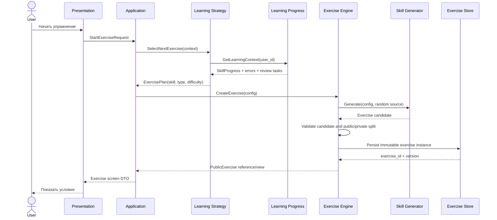
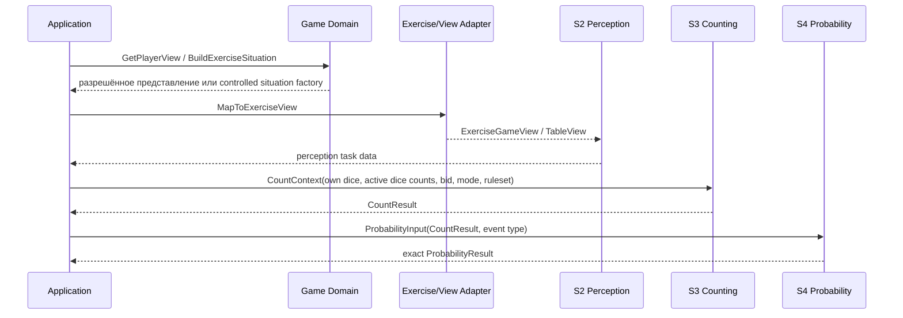
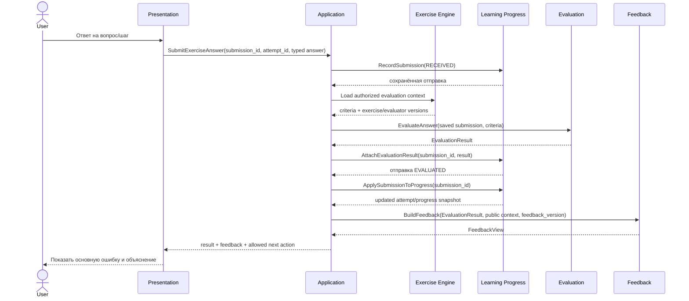
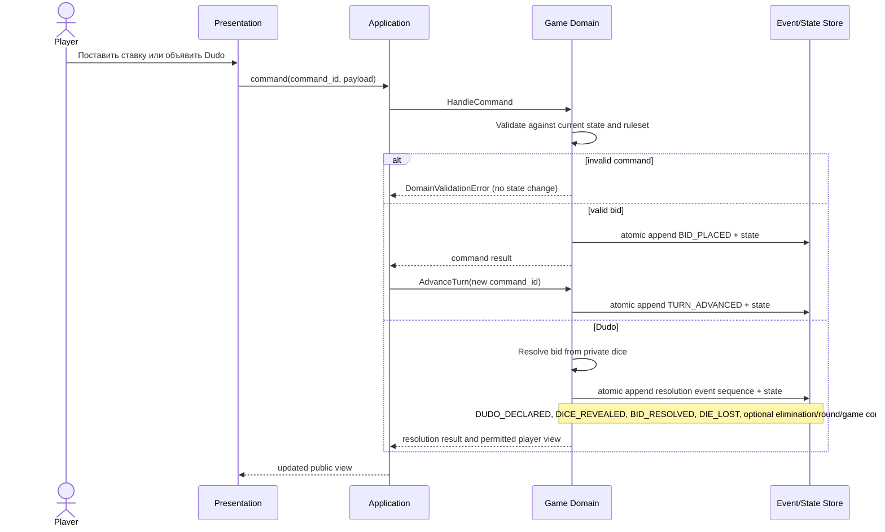
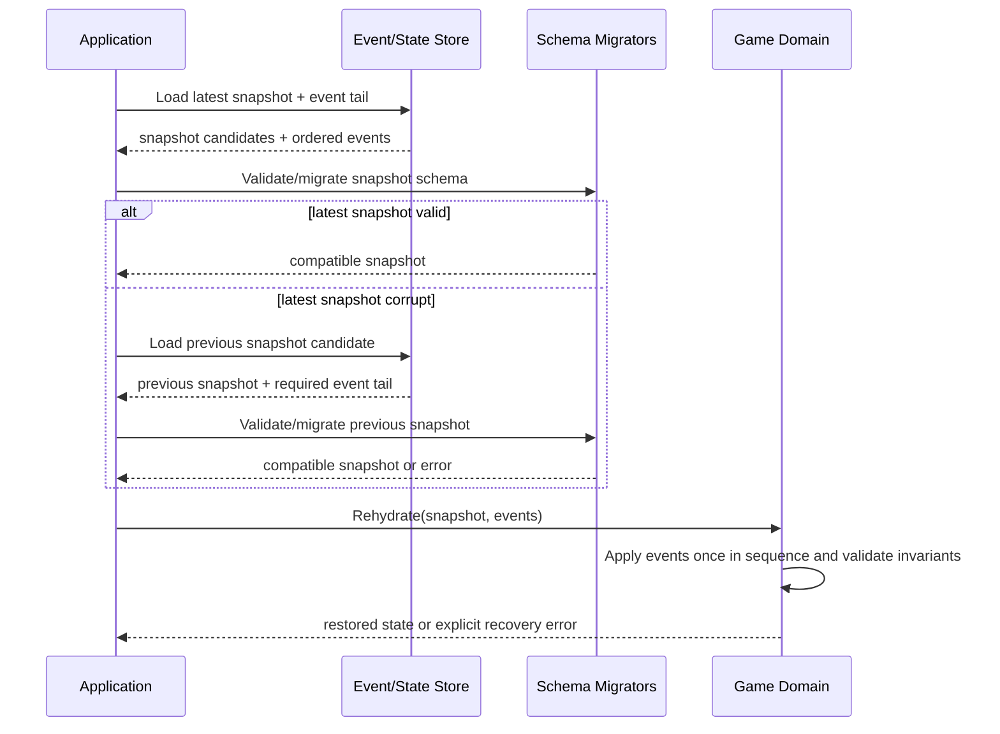

# Perudo — сквозные последовательности и потоки вызовов

Версия: 1.1
Статус: проектный контракт взаимодействия модулей.

Диаграммы описывают логические вызовы внутри модульного монолита. Они не предписывают HTTP, брокер сообщений, фоновые workers или конкретную БД.

## 1. Генерация и показ упражнения



Инварианты:

- экземпляр валидируется до сохранения;
- сохранение завершается до показа пользователю;
- UI получает только `PublicExercise`;
- `PrivateExerciseData` остаётся на стороне владельца;
- seed, generator id/version, config и ruleset id/version сохраняются вместе с экземпляром.

## 2. Подготовка игровой ситуации и расчёты S2 → S3 → S4



Правила границ:

- S2 работает с разрешённым представлением и не получает hidden face values.
- S3 получает значения только собственных кубиков и количества кубиков остальных активных игроков.
- `CountResult` является единственным источником результата собственного подсчёта для S4.
- S4 не пересчитывает собственные кубики и не принимает игровое решение.
- В реальном игровом сценарии Game Domain не должен отдавать S2/S3 закрытые значения; в учебном сценарии генератор может знать полный synthetic state, но публичная и private части остаются разделены.

## 3. Отправка ответа, проверка и обратная связь



При сбое Application возобновляет сценарий с последней подтверждённой стадии по `submission_id`. Feedback строится после сохранения результата проверки. Learning Progress остаётся единственным владельцем отправки и попытки.

Инварианты:

- эталон загружается только доверенной стороной;
- клиент не может прислать свой критерий или ожидаемый ответ;
- каждая отправка сохраняется;
- исправление доступно только после feedback;
- по умолчанию раскрывается только основная ошибка;
- полный эталон открывается после завершения всего упражнения;
- подсказки фиксируются отдельно от правильности.

## 4. Завершение упражнения и обновление прогресса

```mermaid
sequenceDiagram
    participant App as Application
    participant Engine as Exercise Engine
    participant Progress as Learning Progress
    participant Strategy as Learning Strategy

    App->>Engine: GetCompletionCriteria(exercise_id, version)
    Engine-->>App: completion criteria
    App->>Progress: GetAttempt(attempt_id)
    Progress-->>App: attempt + submission/evaluation facts
    App->>App: Check required steps; ignore incomplete optional steps
    App->>Progress: CompleteAttempt(operation_id, completion_context)
    Progress->>Progress: Set status COMPLETED and calculate attempt metrics
    Progress->>Progress: Update SkillProgress, history, ErrorStatistics and ReviewTask
    Progress-->>App: completed attempt + progress snapshot
    App->>Engine: GetExerciseReviewView(attempt_id)
    Engine-->>App: authorized review view with expected answers
    App->>Strategy: GetNextRecommendation(context)
    Strategy->>Progress: Read current skill state
    Progress-->>Strategy: read model
    Strategy-->>App: next ExercisePlan
```

Learning Progress — единственный владелец статуса попытки. Application координирует завершение; Exercise Engine выдаёт эталон только после подтверждённого `COMPLETED`. Evaluation не завершает попытку и не раскрывает эталон.

Learning Progress фиксирует факты и вычисляет состояние навыка по согласованным правилам. Learning Strategy использует результат для выбора следующего шага, но не меняет историю.

## 5. Реальный игровой ход и Dudo



Требования:

- каждый изменяющий состояние вызов имеет `command_id`;
- `BID_PLACED` и `TURN_ADVANCED` — отдельные команды/события;
- повтор `command_id` с тем же payload возвращает прежний результат;
- тот же ID с другим payload — конфликт;
- все события одной команды разрешения Dudo и новое состояние атомарны;
- UI получает только представление, разрешённое конкретному игроку.

## 6. Восстановление партии



Fallback на предыдущий snapshot допустим только если snapshot и весь хвост событий целостны, sequence непрерывен, схемы поддерживаются, миграторы доступны и итоговые инварианты выполняются. Неизвестный `event_type`, повреждённый журнал или неизвестная версия payload останавливают восстановление. Если все snapshots повреждены, но журнал целостен и поддерживается, допускается replay с начала.

## 7. Ошибки и компенсации

Доменные ошибки валидации не являются инфраструктурными ошибками и не должны приводить к частичному изменению состояния.

Ошибки генерации упражнения не записываются как ошибки ученика. Неудачный кандидат не показывается и не создаёт `ExerciseAttempt`.

Если отправка ответа не может быть оценена из-за отсутствующего/несовместимого экземпляра, система возвращает явную ошибку; нельзя подменять критерии текущей версией генератора.

Если обновление Learning Progress повторяется после технического сбоя, повторная обработка одной `submission_id` не должна удваивать счётчики.

## 8. Обязательные интеграционные сценарии

1. Генерация → валидация → сохранение → показ только public view.
2. S2 отображает ситуацию без закрытых значений.
3. S3 считает с учётом NORMAL/PALIFICO и active dice.
4. S4 получает `CountResult` и правильный `p`.
5. Многошаговый ответ → partial credit → feedback → исправление.
6. Повторная отправка не удваивает попытки/метрики.
7. Завершение упражнения обновляет SkillProgress и создаёт не более одной подходящей review task.
8. Дудо-последовательность атомарна и идемпотентна.
9. Восстановление последнего snapshot и fallback на предыдущий.
10. Повреждённое событие/неизвестная схема приводит к явной ошибке.
